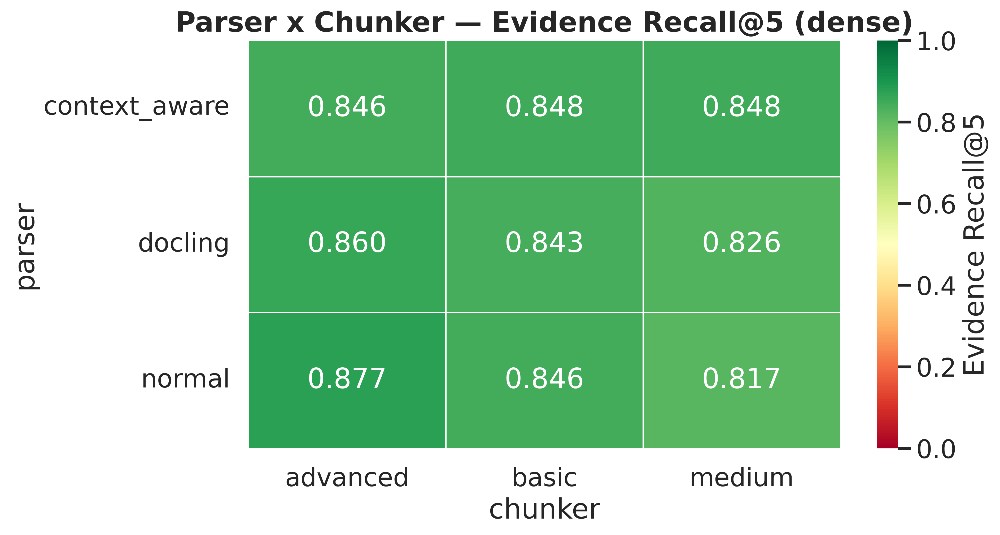
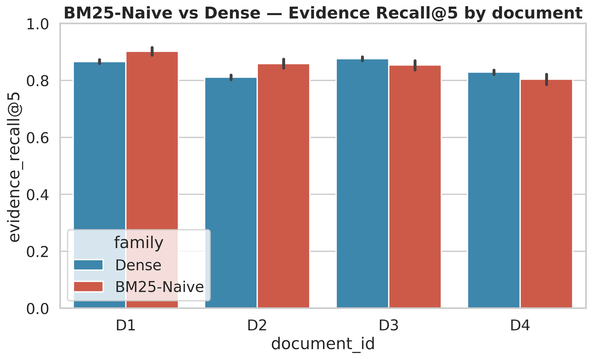
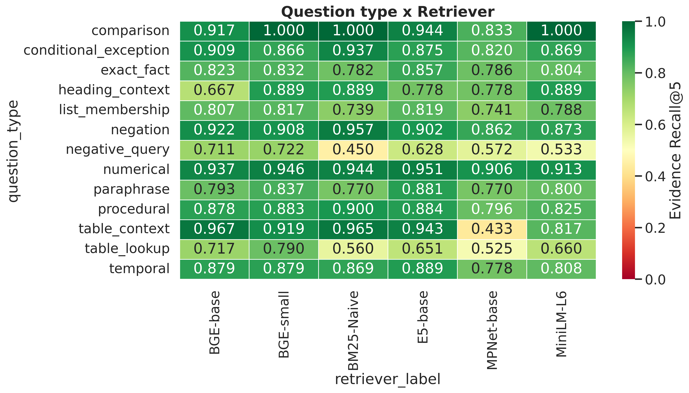
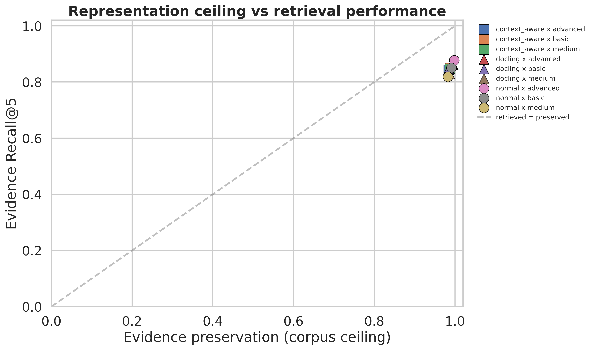
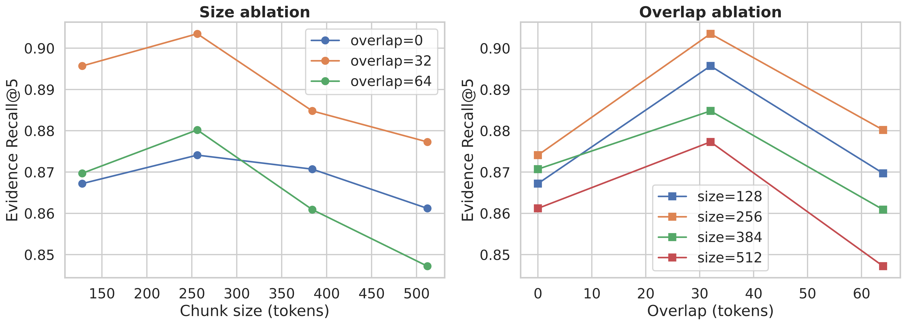
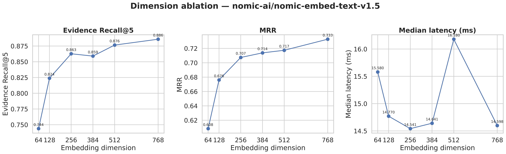
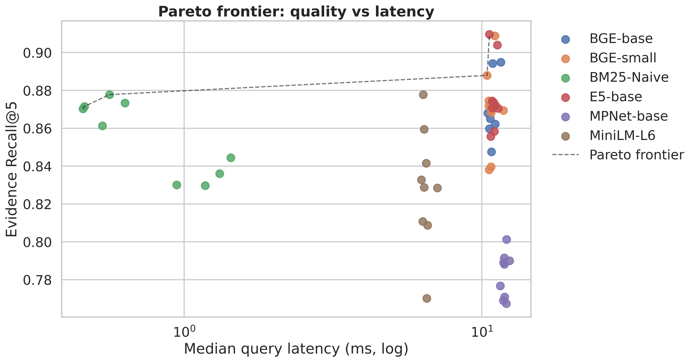

# Parser, Chunking, and Embedding Interactions in Retrieval-Augmented Generation over Indian Government Regulatory Documents

[](https://arxiv.org/abs/2609.31660)
[](https://www.python.org/)
[](LICENSE)

**Research code and supplementary results for a controlled study of how document parsing, chunking, and embedding choices interact in retrieval-augmented generation (RAG).** The benchmark evaluates retrieval over four structurally diverse Indian central-government regulatory documents, with evidence-annotated questions, matched dense-versus-sparse comparisons, statistical analysis, and efficiency/quality ablations.

> **Paper:** [Parser, Chunking, and Embedding Interactions in Retrieval-Augmented Generation over Indian Government Regulatory Documents](https://arxiv.org/abs/2609.31660) · **Code:** [GitHub repository](https://github.com/shubham-61291/pre_generation_rag_retrieval_benchmark)

---

## Overview

RAG pipelines are often assembled by selecting a parser, chunking strategy, and embedding model independently. Those choices interact: a parser can change the structure available to a chunker, while an embedding model can behave differently on tables, rules, definitions, and long-form legal text. Evaluating each component in isolation can therefore obscure the behavior of the complete retrieval pipeline.

This repository provides a factorial evaluation harness for comparing those choices under matched conditions. It includes:

- A **3 × 3 × 5 parser–chunker–embedding sweep** for dense retrieval, plus a BM25 sparse baseline.
- An **800-question, evidence-annotated benchmark** spanning four Indian regulatory documents.
- **54 unique retriever configurations** evaluated with common query evidence.
- Linear mixed-effects models, Holm-corrected paired comparisons, and clustered bootstrap confidence intervals.
- Chunk-size/overlap and embedding-dimension ablations.
- Retrieval-quality versus latency analysis and a representation-preservation audit.
- The benchmark harness, source documents, question/evidence JSON files, figures, and tabular results needed to inspect the reported experiments.

The supplementary result set reports **72,000 query-level evaluations**. The study is **retrieval-only by design**: it isolates retrieval behavior rather than introducing a generation model whose behavior could confound the comparison.

## Research questions

| Question | Focus |
|---|---|
| RQ1 | How do parser and chunker choices interact, and do their effects depend on the embedding model? |
| RQ2 | Does dense retrieval or BM25 perform better consistently across different regulatory documents? |
| RQ3 | Do embedding models exhibit specific weaknesses for different question or evidence types? |
| RQ4 | What quality/efficiency trade-offs emerge when chunk size, overlap, and embedding dimension are varied? |

## Experimental design

### Corpus

The benchmark covers four documents from a single domain: Indian central-government administrative and legal/regulatory text.

| ID | Document | Authority / source context | Structural characteristics |
|---|---|---|---|
| D1 | Central Civil Services (Leave) Rules, 1972 | Department of Personnel and Training (DoPT) | Numerical entitlement tables, accrual and encashment schedules |
| D2 | Central Civil Services (Conduct) Rules, 1964 | DoPT | Prescriptive prohibitions and disciplinary language |
| D3 | Fundamental Rules and Supplementary Rules, Part I | Government rules | Large, heterogeneous, multi-chapter rule hierarchy |
| D4 | Right to Information Act, 2005 | Parliament of India | Long-form legal narrative, definitions, and cross-references |

Each document has a corresponding evidence-annotated set of 200 questions in the repository. See the limitations section for details on question generation and validation.

### Parser configurations

| Parser | Method |
|---|---|
| `normal` | Per-page text extraction using `pypdf`, with splitting on blank-line boundaries |
| `context-aware` | Rule-based heading injection; body elements are prefixed with the most recent heading tag |
| `docking` | Layout-aware conversion to Markdown with Docling, followed by block splitting |

### Chunking configurations

| Chunker | Method |
|---|---|
| `basic` | Fixed-size 256-token windows without overlap |
| `medium` | Recursive / sentence-boundary-aware splitting with a 256-token target and 48-token tail overlap |
| `advanced` | Hierarchical, section-aware chunking with breadcrumb prefixes such as `[Doc: {id} | Section: {heading}]` |

### Retrieval configurations

Five dense embedding models are compared with a sparse BM25 baseline.

| Model | Relative tier | Training regime |
|---|---|---|
| `all-MiniLM-L6-v2` | Small | General-purpose |
| `all-mpnet-base-v2` | Base | General-purpose |
| `bge-small-en-v1.5` | Small | Retrieval-tuned |
| `bge-base-en-v1.5` | Base | Retrieval-tuned |
| `e5-base-v2` | Base | Retrieval-tuned |
| `BM25-Naive` | Sparse baseline | Lexical retrieval |

Dense retrieval uses exact inner-product search through FAISS `IndexFlatIP` over L2-normalized embeddings. Model-appropriate query/passage prefixes are used where applicable, including for BGE and E5.

The dense factorial sweep contains 45 parser × chunker × embedding configurations. BM25 is evaluated across the nine parser × chunker combinations, giving 54 unique retriever configurations in total.

## Metrics and evaluation

The benchmark evaluates the evidence surfaced in the top-*k* retrieved chunks against the required evidence strings annotated for each query.

| Metric | Interpretation |
|---|---|
| **Evidence Recall@k** | Fraction of required evidence strings matched by the union of top-*k* retrieved chunks |
| **Hit@k** | Whether at least one required evidence string is matched |
| **Full@k** | Whether all required evidence strings are matched |
| **MRR** | Reciprocal rank of the first chunk matching required evidence |
| **nDCG@5 / nDCG@10** | Ranking quality based on newly matched evidence |
| **Evidence coverage** | Corpus-level audit of whether required evidence survives parsing and chunking |
| **Latency** | Retrieval query latency, used in the efficiency/quality analysis |

The statistical model uses `recall_10` as the primary mixed-effects outcome. Several diagnostic figures and configuration comparisons report Recall@5; the metric used is identified in the corresponding figure or table caption.

A chunk matches an evidence string when either (a) its whitespace-normalized, lower-cased text contains the normalized evidence string as a substring, or (b) at least 80% of the evidence string's tokens are present in the chunk.

## Statistical methodology

### Linear mixed-effects models

The dense configurations are analyzed using a parser × chunker × embedding model with a query-level random intercept. BM25 is analyzed separately without an embedding factor.

```text
Dense: recall_10 ~ Parser * Chunker * Embedding + (1 | query)
       45 parser × chunker × embedding cells

BM25:  recall_10 ~ Parser * Chunker + (1 | query)
       9 parser × chunker cells
```

### Matched comparisons and uncertainty

- Dense configurations are compared with their query-matched BM25 counterpart under the same document, parser, and chunker conditions.
- Paired-comparison p-values are adjusted with the **Holm correction**.
- **Clustered bootstrap 95% confidence intervals** are computed using 2,000 resamples over query-level means for all 54 unique configurations.
- The embedding-dimension ablation uses a pre-declared configuration selection rule to reduce the risk of post-hoc selection.

## Key findings

These findings describe the benchmark corpus and experimental conditions; they should not be treated as universal rankings for all RAG applications.

### 1. Parser and chunker performance is interactive

The strongest configuration cannot reliably be selected by ranking parsers and chunkers independently. The dense mixed-effects analysis reports significant parser and chunker effects and interactions, including differences in how normal or layout-aware parsing combines with the medium chunker.



*Figure: Mean dense Evidence Recall@5 by parser and chunker, averaged over embedding models and documents.*

### 2. Dense retrieval does not always beat BM25

The best retrieval family varies by document. BM25 performs better on the leave and conduct rules in this benchmark, while dense retrieval performs better on the Fundamental Rules and the RTI Act. Some matched differences remain significant after Holm correction. Several embedding models outperform matched BM25 in a majority of parser/chunker cells, but no family dominates every document.



*Figure: Dense retrieval (best-of-five mean) versus BM25-Naive by document.*

**Practical implication:** compare sparse and dense retrieval on the target corpus instead of selecting a retrieval family based only on aggregate scores.

### 3. Embedding weaknesses can be content-specific

`all-mpnet-base-v2` exhibits a pronounced weakness on `table_context` questions in this dataset. The effect persists across all three parser configurations, suggesting that it is not explained by a single parser choice. `table_lookup` and `negative_query` are challenging question categories for all evaluated retrievers.



*Figure: Evidence Recall@5 by question type and retriever.*

### 4. Evidence preservation is near saturation, but ranking still varies

Corpus-level mean evidence coverage ranges from **0.983 to 0.998** across the nine parser/chunker combinations, while the fraction of queries with complete coverage ranges from **0.980 to 0.996**. This separates two failure modes: whether useful information survives ingestion, and whether retrieval ranks that information highly enough to return it.



*Figure: Retrieval recall compared with corpus-level evidence preservation.*

### 5. Chunk-size and overlap ablations favor a moderate configuration

Across the tested values, a **32-token overlap** outperforms 0- and 64-token overlap at each tested chunk size. The reported best combination is **256-token chunks with 32-token overlap**, with Recall@5 of approximately **0.90**. Larger tested chunks of 384 and 512 tokens do not improve on 256 tokens in this ablation.



### 6. Higher embedding dimensions yield diminishing retrieval gains

In the reported `nomic-embed-text-v1.5` dimension ablation, Recall@5 rises from **0.744 at 64 dimensions** to **0.863 at 256 dimensions** and **0.886 at 768 dimensions**. Median query latency remains approximately **14.5–16.2 ms** across the tested dimensions, making index storage the more visible cost of higher dimensionality in this experiment.



### 7. Quality and latency form a trade-off

BM25 configurations occupy the low-latency region, with sub-millisecond median latency and a recall trade-off. `docling + advanced` paired with BGE-small or E5-base anchors the high-quality end. No configuration provides both the highest recall and lowest latency.



## Reproducing the benchmark

### Requirements

- Python 3.9, as specified in the original experiment setup
- The pinned packages listed in [`requirements.txt`](requirements.txt)
- Sufficient disk space for source documents, parser caches, embedding models, result tables, and figures
- Internet access on the first run if required packages or embedding models need to be downloaded

The experiment includes layout-aware parsing and multiple embedding models. The first complete run may take substantial time and disk space; use the checkpointed outputs when you only need to inspect released results.

### Setup

```bash
git clone https://github.com/shubham-61291/pre_generation_rag_retrieval_benchmark.git
cd pre_generation_rag_retrieval_benchmark

python -m venv .venv
```

Activate the virtual environment.

**Linux / macOS**

```bash
source .venv/bin/activate
```

**Windows PowerShell**

```powershell
.\.venv\Scripts\Activate.ps1
```

Install the pinned dependencies and run the benchmark:

```bash
python -m pip install --upgrade pip
python -m pip install -r requirements.txt
python pre_generation_rag_retrieval_benchmark.py
```

The original harness is also documented as installing missing dependencies automatically. Installing from `requirements.txt` first is recommended for a controlled, repeatable environment.

### Expected workflow

The full run performs the following major stages:

1. Parse the four regulatory PDFs using each parser configuration, using a parser cache where available.
2. Generate chunk sets for all parser × chunker combinations.
3. Run the dense and BM25 retrieval sweep across the configurations.
4. Compute evidence-level retrieval metrics.
5. Fit mixed-effects models and run Holm-corrected paired comparisons.
6. Compute clustered bootstrap confidence intervals.
7. Run embedding-dimension and chunk-size/overlap ablations.
8. Generate result tables and figures for inspection.

The released README identifies `benchmark_v12_evidence_recall_v1/` as the generated output location, with figures in a `figures/` subdirectory. The repository also includes released CSVs and figures at the repository root for direct inspection.

## Released results and artifacts

The repository contains the experiment harness, four source PDFs, four 200-question evidence-annotated JSON files, figures, and CSV result tables. Examples include:

- `master_results.csv` — query-level results
- `mixedlm_dense_3x3x5.csv` and `mixedlm_bm25naive_3x3.csv` — model outputs
- `paired_dense_vs_bm25naive_holm.csv` — Holm-corrected matched comparisons
- `bootstrap_ci_clustered.csv` — clustered bootstrap intervals
- `audit_coverage.csv` and `audit_ceiling.csv` — evidence-preservation audits
- `dimension_ablation.csv` and `chunk_size_overlap_ablation.csv` — ablation outputs
- `efficiency_pareto.csv` — quality/efficiency comparison

The plots embedded above are version-controlled image files, so they can be inspected directly on GitHub without running the full benchmark.

## Reproducibility and interpretation

The research artifact documents configuration hashes, checkpointed run state, per-query result tables, and a corpus manifest containing source URLs, retrieval dates, and SHA-256 hashes of the PDF bytes. Use the released source and result files when comparing results with a new run; reruns can be affected by package, model, and hardware differences if the environment is not held constant.

The evidence matcher is based on normalized string/token overlap, not semantic entailment. Interpret its metrics as evidence-string retrieval measures under the benchmark's annotation and matching rules, rather than as a complete measure of answer correctness.

## Limitations

- **Narrow corpus:** Four documents from one domain are not enough to establish that the findings generalize to other regulatory domains, scientific literature, customer-support knowledge bases, or languages.
- **Question-generation process:** The question/evidence pairs were generated by an LLM under a verbatim-evidence-constrained schema, followed by a 10% manual spot-check and deduplication pass. They were not fully human-authored, and formal inter-annotator agreement was not measured.
- **Retrieval-only evaluation:** The benchmark excludes answer generation. It does not establish whether retrieval improvements translate into better final responses or downstream decisions.
- **Near-ceiling preservation:** Because evidence coverage is high for most parser/chunker pairs, coverage has limited ability to discriminate between them. The reported effects are principally about ranking and retrieval, not widespread loss of source content.
- **No cross-encoder reranking or fused hybrid baseline:** A cross-encoder reranker and a combined sparse+dense retrieval stage are not evaluated. Both are natural candidates for follow-up work.
- **Evidence-matching heuristic:** Substring and token-overlap matching can miss semantically equivalent evidence or count lexical overlap without establishing entailment.

## Intended use

This benchmark is intended for:

- RAG practitioners choosing parsers, chunkers, and embedding models for structured policy or regulatory corpora.
- Retrieval researchers studying component interactions under matched comparisons.
- Benchmark designers separating representation preservation from ranking failure.
- Framework authors evaluating default chunking and embedding configurations.

It should be treated as a research benchmark and engineering reference, not as proof that one configuration is best for every dataset.

## Citation

If you use this code or results, please cite the associated paper:

```bibtex
@misc{singh2026parserchunkingembedding,
  title         = {Parser, Chunking, and Embedding Interactions in Retrieval-Augmented Generation over Indian Government Regulatory Documents},
  author        = {Singh, Shubham Kumar},
  year          = {2026},
  eprint        = {2609.31660},
  archivePrefix = {arXiv},
  url           = {https://arxiv.org/abs/2609.31660}
}
```

- **Paper:** https://arxiv.org/abs/2609.31660
- **Code and results:** https://github.com/shubham-61291/pre_generation_rag_retrieval_benchmark

## Author

**Shubham Kumar Singh**

## License

This project is released under the [Apache License, Version 2.0](LICENSE).
